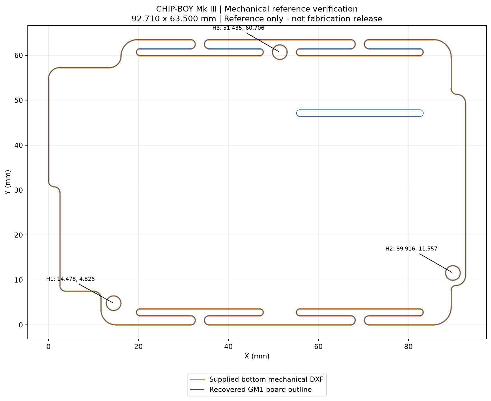

<h1 align="center">Kerf_Boy</h1>
<p align="center"><b>A module-based wearable electronics carrier, rebuilt from CHIP-BOY Mk III references for EasyEDA Pro.</b></p>
<p align="center">Kerf project by Redwan Ahmmed · Target CAD: EasyEDA Pro · Status: engineering reconstruction</p>

## What is it?

Kerf_Boy is a carrier-PCB redesign for a wrist-mounted device built around the Seeed Studio XIAO ESP32-S3 Sense. The source design combines an OLED, motion/environment/distance sensors, GPS, DFPlayer audio, buttons, a rotary encoder, illumination and battery monitoring.

The requirement is to **retain the original through-hole components and plug-in modules**, while improving the carrier circuitry and routing. This repository preserves source evidence, reconstructed footprints, mechanical references, verification results and the remaining design work.

> **Not ready to manufacture.** All 40 component footprints and native schematic bindings have been digitally checked. Exact-part qualification, circuit design, routing and prototype validation remain unfinished. The review board contains no routed circuit. See [production readiness](docs/PRODUCTION_READINESS.md).

## Start here

- [Latest GP7/navigation verification report](docs/reports/gp7-navigation-checkpoint.md)
- [Latest saved EasyEDA project](hardware/easyeda/qualification-fixes/native-gp7-navigation-review.epro2)

- [Latest manufacturer qualification report](docs/reports/part-qualification-review.md)
- [Current EasyEDA archive and corrected encoder](hardware/easyeda/qualification/README.md)

- [Latest Step 3 component and binding report](docs/reports/step-3-component-binding-report.md)
- [Hardware and footprint guide](hardware/README.md)
- [Complete reconstruction report (PDF)](docs/reports/complete-reconstruction-report.pdf)
- [Production readiness and unresolved work](docs/PRODUCTION_READINESS.md)
- [Verification and reproduction](docs/VERIFICATION.md)
- [Source provenance and licensing scope](docs/PROVENANCE.md)
- [Change history](CHANGELOG.md)

## Features being preserved

| Area | Original design requirement |
|---|---|
| Controller | XIAO ESP32-S3 Sense with camera, microphone and microSD |
| Display | Original 1.3-inch 128 x 64 OLED interface |
| Sensors | Original BNO055, BME280 and TOF400C module interfaces |
| Navigation | GPS module, rotary encoder, buttons and navigation switch |
| Audio | DFPlayer, speaker connection and buzzer function |
| Power and outputs | Single-cell battery concept, battery sensing, three LEDs and laser interface |

These describe the intended system, not tested capabilities of this rebuild. Exact part identities and unresolved electrical interfaces are tracked in the report.

## Repository layout

```text
Kerf_Boy/
├── README.md
├── AGENTS.md                 # Design constraints and future push workflow
├── CHANGELOG.md
├── hardware/
│   ├── README.md
│   ├── reference/original/   # Immutable supplied design evidence (50 files)
│   ├── reconstruction/       # Review boards, libraries, pin maps and checks
│   └── easyeda/              # Native-project status and conversion instructions
├── mechanical/               # Geometry guide and references to recovered DXFs
├── firmware/                 # Firmware status and required integration work
├── docs/
│   ├── PRODUCTION_READINESS.md
│   ├── VERIFICATION.md
│   ├── PROVENANCE.md
│   ├── ORDERING.md
│   ├── reports/              # Full report and historical engineering records
│   ├── images/               # Mechanical and hole-map previews
│   └── history/              # Explicitly superseded research
└── scripts/                  # Portable recovery and verification tools
```

## Verified reconstruction at a glance

| Item | Current evidence |
|---|---|
| Reference envelope | 92.710 x 63.500 mm |
| Original copper layers | Four: top, internal GND, internal 3V3, bottom |
| Review board | Two-layer geometry carrier only; no traces/netlist |
| Source files | 50 originals preserved with SHA-256 fingerprints |
| Component library | 40 footprints in the current EasyEDA review; historical 24-group evidence retained |
| Component/locator features | 138 round holes and two plated routed slots |
| Additional small holes | 51 via candidates, outside component footprints |
| Current bindings | 179 electrical pins/pads, 40 symbols/footprints; full circuit equivalence unverified |
| Independent geometry read-back | Passed at 0.000002 mm comparison tolerance |
| EasyEDA review | Complete component import and binding sheet saved; embedded libraries independently checked |
| Binding-review DRC / hardware test | 0 fatal, 0 errors, 1 shield-pin warning / physical test not performed |



## Review locally

```sh
git clone https://github.com/redwan2003-bot/Kerf_Boy.git
cd Kerf_Boy
python scripts/verify_repository.py
```

Open `hardware/reconstruction/complete-geometry-review.kicad_pcb` for positional review, or follow [EasyEDA status and import notes](hardware/easyeda/README.md). This is an intermediate CAD artifact, not a completed EasyEDA design. See [verification instructions](docs/VERIFICATION.md) for optional geometry regeneration.

## Project status

- [x] Source audit and digital mechanical-reference checks
- [x] Through-hole geometry recovery and independent CAD read-back
- [x] Reconstruction report and structured repository
- [x] Reconstruct and check 40 footprint bindings and 179 pin/pad matches in saved EasyEDA archive
- [ ] Finish exact-part qualification, body/courtyard geometry and physical fit checks
- [ ] Finalize power and GPIO architecture, including microSD conflicts
- [ ] Complete schematic, layout, routing and meaningful ERC/DRC
- [ ] Verify manufacturing exports and test a physical prototype

## Credits and license

The supplied CHIP-BOY Mk III schematic credits Victor Ranulfo Molina. Original material is kept as reference with its original markings. Repository organization follows [Kerf_Keeb](https://github.com/redwan2003-bot/Kerf_Keeb). See [LICENSE](LICENSE) and [provenance](docs/PROVENANCE.md); the repository license does not establish ownership of third-party source material.
