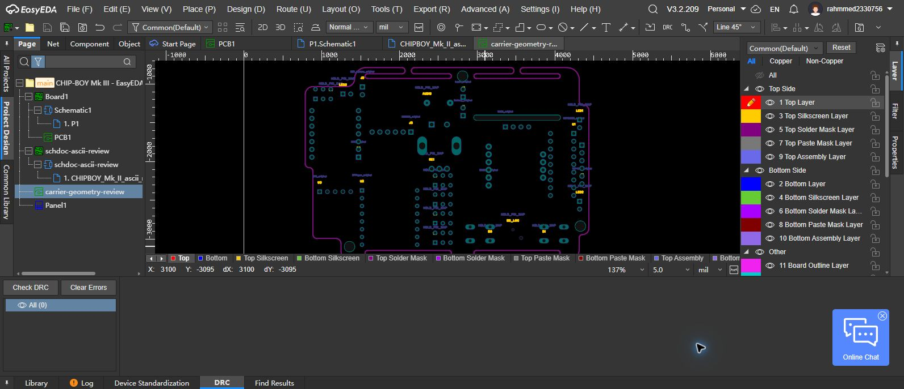
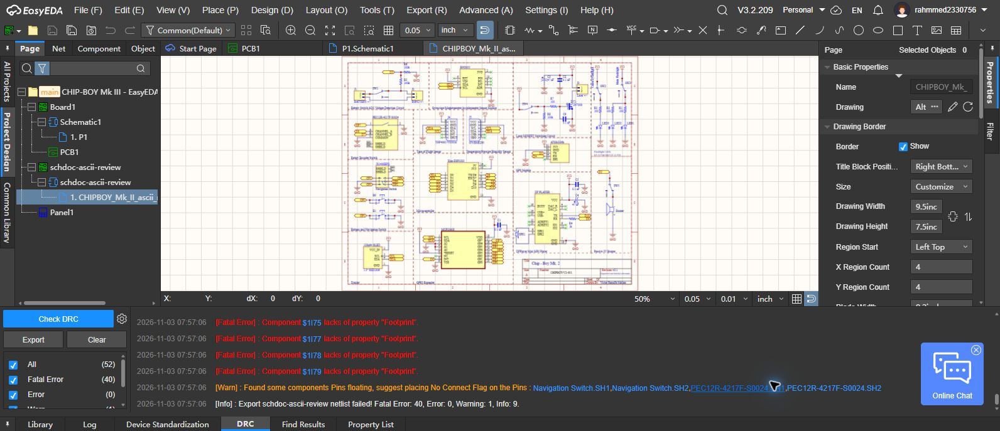

# EasyEDA import and Step 3 verification report

Date: 2026-11-03. **Step 3 is incomplete; these are review artifacts.**

## Completed in EasyEDA

The supplied Mk II schematic was converted to an experimental ASCII review copy and imported into the user's existing EasyEDA Pro project. The conversion removes binary length prefixes and terminators from 1,236 FileHeader records, changing only the file-format header. This is not a native Altium Save As export. Import rendered the circuit and retained all 40 component designators and all 40 original footprint-name attributes. Native identifiers were regenerated.

EasyEDA imported 30 device definitions and 19 symbols. Six duplicate-name variants were reported as bound to existing definitions. In particular, BME280 and TOF400C share the original `PPTC061LFBNRC` library reference despite differing pin names. Subsequent archive inspection confirms all 179 pin number/name pairs across all 40 component instances match the source. BME280 and TOF400C retained separate symbols despite the shared source name. Wire connectivity and electrical pin types have not yet been verified. Automatic footprint association and automatic 3D assignment were disabled; existing library definitions were not overwritten.

The reconstructed carrier was imported into the same project. The native PCB page contains 24 component groups and 140 pad references. The source reconstruction accounts for 138 round component/locator holes and two routed slots. The separate 51 small via candidates are not component pads. No routes or meaningful electrical nets have been added.

An independent input check found the first import copy contained two identical copies of the outline. This was an import-preparation error. The generator now copies the already outlined review board without adding another outline. The five duplicate native shapes were removed through EasyEDA's File Source editor, saved and read back: one outer POLY and four cutout FILL objects remain. The corrected input has 759 outline segments.

## Verification results and limits

| Check | Result |
|---|---|
| Original 50-file snapshot | Repository hash check required and recorded with this update |
| Independent reconstruction read-back | 24 groups, 138 round pads, two slots; maximum difference 1.42e-14 mm |
| Native schematic reference/name retention | 40/40 designators and 40/40 origin footprint names pass |
| Native PCB document counts | 24 groups, 140 pad references, one outer outline, four cutouts |
| Native schematic DRC during netlist export | 40 fatal missing-footprint findings, zero other errors, one shield-pin warning; export did not complete |
| Embedded footprint dimensional comparison | 140/140 positions, pad sizes, unordered drill dimensions and identifiers pass; maximum difference 0.00000064 mm |
| Native symbol pin number/name retention | All 179 pin instances across 40 components pass |
| Electrical net equivalence, manufacturing DRC, hardware tests | Not verified |

The native `.esch` and `.epcb` files were read from the editor's visible File Source. They reference external library UUIDs and are not a complete portable project. The user completed both archive downloads after browser control could not access the downloads page. Both ZIP containers are readable. The project archive predates the outline correction and is explicitly named `native-review-before-outline-fix.epro2`; the corrected native page is stored separately. Its embedded libraries enabled the dimensional and symbol-pin checks.

## H098 plane finding

A new topology check clips the internal negative-Gerber copper to the reconstructed board and subtracts all round drill holes and routed slots. H098 and five comparison holes touch the same GP2 copper polygon as the known 3V3 anchor H136, and do not touch the GP1 ground polygon. This resolves the earlier partial-ring-sampling ambiguity as **source-plane connectivity to 3V3**. The parser is shared with the earlier trace tool, polygon curves are approximated, and this is not physical continuity testing. It does not establish individual switch pin numbers.

## Remaining Step 3 work

1. Complete native slot-orientation and solder-mask checks; export a fresh full archive containing the corrected outline.
2. Verify imported electrical pin types and wire connectivity; pin numbers and names now pass for every source instance.
3. Establish exact physical switch, encoder and button numbering, including shield pins, without promoting source hole IDs to guessed pin numbers.
4. Bind verified original modules and through-hole footprints; retain Mk II/Mk III revision differences explicitly.
5. Rerun native electrical checks and export a complete corrected project with its libraries.

Steps 1 and 2 remain completed only within their recorded source-audit and digital-mechanical scope. Neither is a claim of physical fit or production readiness. Battery/module variants, architecture review, routing, manufacturing outputs and prototype testing remain later work.

