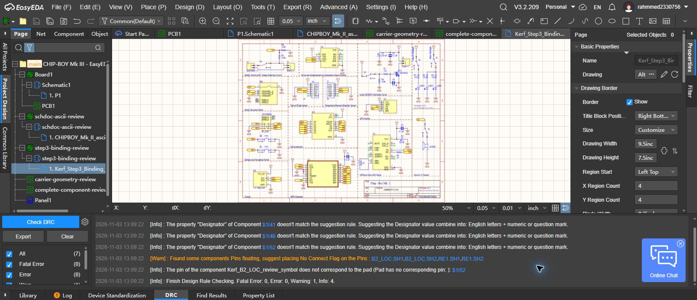

# Step 3 component reconstruction and binding report

Updated 2026-11-03. **Digital reconstruction and native binding verified; physical/package qualification remains open. Do not manufacture this review.**

## Delivered

The existing [EasyEDA Pro project](https://pro.easyeda.com/editor#id=987575100d2f4542bfc9780160616df2) contains `complete-component-review` and a separate `Kerf_Step3_Binding_Review` schematic under `step3-binding-review`. Earlier reference sheets are retained. The new review contains all 40 components, 179 electrical pads and two non-plated navigation locating holes. Original through-hole geometry and modules have been retained; no substitute breakout was selected.

The [final native archive](../../hardware/easyeda/step3-numbered/native-bound-review.epro2) includes the embedded libraries and all 40 schematic footprint bindings. The [artifact guide](../../hardware/easyeda/step3-numbered/README.md) identifies the other files. The PCB is an unrouted geometry review, with no circuit net assignment. It is not the completed carrier redesign.

## Verification actually performed

| Check | Result | Limit |
|---|---|---|
| Upstream native schematic provenance | SHA-256 exactly matches the user-supplied SchDoc | Mk II, not proof of complete Mk III equivalence |
| Previously held round-pad numbering | 51 pad positions matched native PCB under rigid transforms; maximum difference 0.000264 mm | Original assembly/copper orientation also considered; buzzer polarity is explicitly a redesign assignment |
| Original drilled geometry | 138 round holes and two routed slots retained; no duplicate hole assignment | Physical fit has not been tested |
| Remaining 16 SMD footprints | 33 copper pads checked against Mk III Gerbers, with matching side | Uniform mask expansion differs from separately rounded original aperture axes by at most 0.000254 mm |
| Navigation-switch SMD geometry | All eight pads contained in original copper, mask and paste within 0.001 mm comparison tolerance | Digital conversion tolerance, not fabrication capability |
| Native EasyEDA library readback | 40 footprints, 181 pads; positions, sizes, drills, pad IDs, angles, plating and slot axes pass; maximum geometry difference 0.0000001261 mm | Comparison to the reconstructed input |
| Final saved archive | 40 bindings; all 179 symbol pin names/numbers and electrical pad sets match; checked footprint geometry unchanged | Does not validate the retained reference circuit |
| EasyEDA schematic DRC | 0 fatal, 0 errors, 1 warning, 4 informational findings in the completion line | Not PCB DRC or electrical qualification |

The DRC warning names floating `B2_LOC.SH1`, `B2_LOC.SH2`, `RE1.SH1` and `RE1.SH2`. It remains visible pending the grounding decision. Informational findings cover three nonstandard designators and blank-number mechanical locator pads. No warning was suppressed merely to obtain a clean count.

## Source and revision decisions

The author's native Mk II PCB was recovered from [the upstream Altium directory](https://github.com/hungggryvic/Chip-Boy/tree/main/CHIP_BOY_Mk_II_PCB_AltiumFiles). Its companion schematic exactly matches the supplied schematic. This provides substantially stronger footprint pin-identity evidence than guessing from drill positions. The downloaded files are separately attributed and fingerprinted; the original 50-file snapshot is unchanged.

Mk III fabrication outputs remain authoritative for geometry. Mk II axial resistors, radial capacitors and TO-92 MOSFET were not copied into Mk III. The reconstructed Mk III resistors and capacitors are SMD; T1 uses the original Mk III AO3400A SOT-23 pattern. T1's review symbol is remapped to G1/S2/D3, consistent with the Mk III drawing and [AO3400A manufacturer datasheet](https://www.aosmd.com/sites/default/files/res/data_sheets/AO3400A.pdf). The speaker uses pads 1/2 instead of the older symbol's P/M. C3/C4 comments are updated to the Mk III 100 uF value. R1–R3 references are reconciled with the Mk III LED positions.

Switch numbering comes from the matching native PCB. Its six schematic pins overlap in pairs 1/2, 3/4 and 5/6; this is not evidence of two independent switch poles. Encoder A/B/C, push contacts and shields retain distinct identities. Original routed encoder slots remain slots.

The buzzer footprint P/N orientation is deliberately assigned to the Mk III positive/ground terminals. The older native PCB's polarity appears reversed. J2 also has a polarity difference between revisions. The binding review retains reference wires and **does not resolve these circuit differences**. These are explicitly carried into the circuit redesign, not approved by a successful pin-count check.

## What remains before full Step 3 qualification

The completed digital work is a 40-component reconstruction and binding review. Full part qualification is still incomplete: exact module revisions and purchasing identities, body/actuator heights, complete body/courtyard/keepout geometry, connector and battery details, and ratings have not been established from matching manufacturer drawings or actual parts. Existing generic module descriptions do not supply those details. No 1:1 physical fit or continuity test has occurred.

Subsequent design work must resolve the battery/power architecture, GPIO and microSD conflicts, BNO055 mode straps, load budgets, buzzer/header polarity, shield grounding and full circuit connectivity. Then the carrier needs placement, routing, actual stackup/rules, PCB DRC, manufacturing outputs and prototype verification. Stage 1 source audit and Stage 2 digital mechanical evidence are unchanged; neither is a physical qualification.

## Reproduction

Run the repository integrity check, the historical footprint roundtrip check, and the new Step 3 checks listed in [verification instructions](../VERIFICATION.md). Reports contain their comparison scope and tolerances. The final archive check uses saved native library records, not a claim based only on clicking Save.
